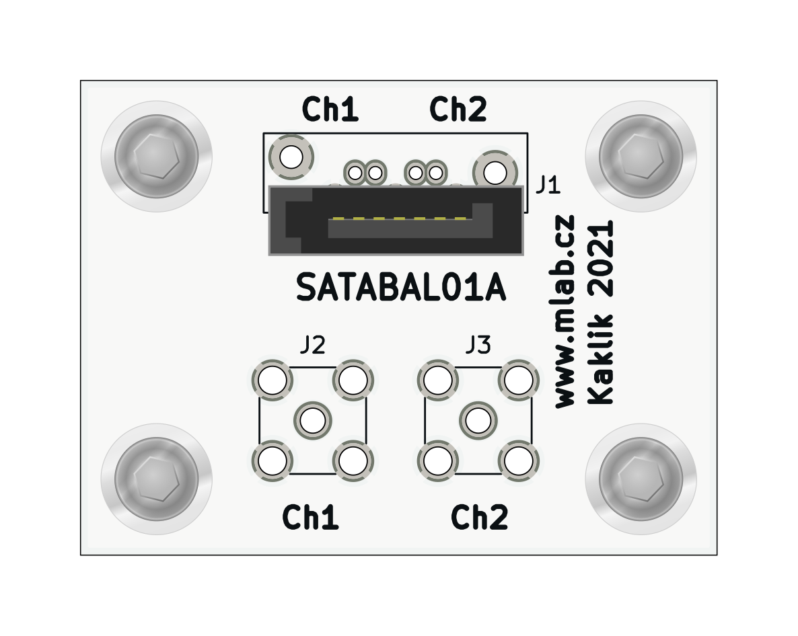

# SATABAL01 - passive coax to SATA balun module 

SATABAL01 is a passive RF balun module designed to interface high-speed differential pairs used in SATA data lines with unbalanced coaxial transmission lines. This module is primarily intended for applications requiring measurement, testing, or signal routing of SATA signals over RF-grade coaxial cables.

## Features

- Converts differential SATA signals to unbalanced RF signals and vice versa
- Suitable for signal bandwidths from 4.5 MHz to 3000 MHz
- Dual-channel design for full SATA differential pair
- Standard SATA connector (J1)
- MCX or SMA coaxial connectors (J2, J3)
- Uses Mini-Circuits TC1-1-13MX+ wideband RF balun transformers
- Compact design suitable for integration into test setups or embedded systems

## Functional Description

The module contains two identical wideband RF balun transformers (Mini-Circuits TC1-1-13MX+), each used to convert one differential signal pair to a single-ended signal. The SATA connector (J1) provides two differential pairs. Each pair is routed through a balun (T1, T2), with the single-ended outputs available at connectors J3 and J2 respectively. These connectors support either MCX or SMA types depending on user preference.

## Electrical Specifications (Per Channel)

Based on the TC1-1-13MX+ balun:

- **Impedance Ratio**: 1:1  
- **Frequency Range**: 4.5 MHz to 3000 MHz  
- **Insertion Loss**:  
  - 4.5–1000 MHz: typ. 1.0 dB  
  - 1000–2000 MHz: typ. 2.0 dB  
  - 2000–3000 MHz: typ. 3.0 dB  
- **Amplitude Unbalance**: typ. 0.5 dB (up to 2000 MHz)  
- **Phase Unbalance**: typ. 2–3 degrees (up to 2000 MHz)  

> Refer to the [TC1-1-13MX+ datasheet](https://www.minicircuits.com/pdfs/TC1-1-13MX+.pdf) for detailed transformer characteristics【7†source】.

## Schematic Overview

- **J1**: SATA 7-pin connector (AMP 67491-1030)
- **T1, T2**: Mini-Circuits TC1-1-13MX+ transformers for each differential pair
- **J2, J3**: Output via MCX/SMA connectors
- **H1–H4**: Mounting pads and ground.

## Typical Use Cases

- Probing SATA lines with RF measurement equipment
- High-frequency signal transmission over coaxial cable
- Balancing/unbalancing of high-speed digital signals and clock

## Assembly Notes

- Ensure correct orientation of baluns as per datasheet marking.
- Match connector types (MCX or SMA) to your coaxial cabling needs.
- Use controlled impedance traces for differential signal integrity.

